# 本地图文教程

本页与应用内教程同步，按 TabDo 1.2.1 的实际行为审校。应用入口为“设置 → 关于 → 阅读本地图文教程”，正文和插图随程序提供，断网可读。

教程不自动弹出，不代你运行工具、创建练习文件或改变资料。可以按目录挑选章节，使用自己的测试副本跟着操作。

## 目录

1. [从这里开始](#start)
2. [超级面板与匹配](#panel)
3. [剪贴板与收藏](#clipboard)
4. [便签与悬浮图片](#notes)
5. [截图、取色与标记](#capture)
6. [文字、公式与翻译](#recognition)
7. [文件搜索与整理](#files)
8. [图片处理与拼接](#images)
9. [视频处理与录屏](#video)
10. [扫码与网页快开](#web)
11. [快捷键与插件](#plugins)
12. [备份、迁移与排查](#backup)

## 从这里开始

TabDo 通过鼠标旁的超级面板打开工具。本章先区分设置、面板和教程三个入口，再由你选择要尝试的功能。

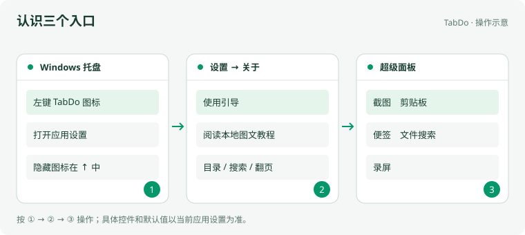

_从托盘打开设置，在关于页进入教程；从超级面板打开工具。插图为操作示意，具体控件以当前应用为准。_

### 开始前

启动 TabDo。使用仓库免安装预览时，请双击 PreviewPortable.cmd；普通下载版按自己的安装方式启动。教程只提供说明和插图，操作由你完成。

### 跟着做

1. 在 Windows 任务栏右侧找到 TabDo 托盘图标；隐藏的图标可能在向上箭头中。左键单击图标打开应用设置。

2. 在设置侧栏选择“关于”，点击“阅读本地图文教程”。左侧目录切换章节，搜索框按教程正文查找操作。

3. 到“通用设置 → 超级面板”确认开关、触发鼠标键和按住时间。按当前配置操作；已有设置不会因阅读教程而改变。

4. 在桌面空白处按配置的鼠标方式呼出面板，选择固定工具。首次常用固定项为截图、剪贴板、便签、文件搜索和录屏。

5. 应用快捷键首次全部关闭，需要时到“快捷键”自行启用。Ctrl+C 等标准文本编辑按键仍按所在应用的规则使用。

### 应看到的结果

能够分别打开设置、教程和超级面板。关闭教程不会创建练习进程、桌面样例或自动更改工具配置。

### 遇到问题

**找不到托盘图标或面板？** 先确认程序仍在运行并展开系统隐藏图标。检查超级面板开关；右键托盘查看是否开启游戏模式，游戏模式会暂停面板鼠标触发与全局快捷键。

**按快捷键没有反应？** 首次安装没有预设应用快捷键。在“快捷键 → 内置快捷键”启用所需操作；设置页呼出快捷键也需要单独录制。

## 超级面板与匹配

在空白处呼出面板可打开固定工具；先选中内容再呼出，可查看适合当前文本、图片、文件或窗口的操作。

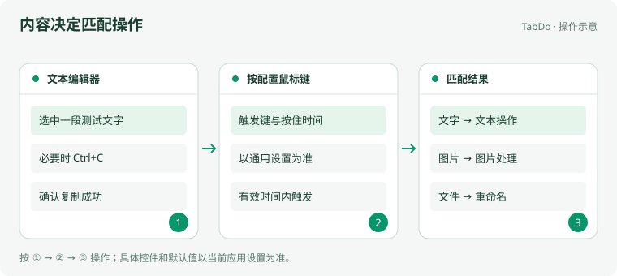

_选择内容、呼出面板、从匹配结果执行操作。插图为操作示意，具体控件以当前应用为准。_

### 开始前

在“通用设置 → 超级面板”确认触发键和按住时间。用自己准备的测试文字，避免初次试用时直接操作重要文件。

### 跟着做

1. 在桌面空白处触发面板，观察固定工具。用户已保存的固定顺序会继续保留。

2. 在文本编辑器选中一小段文字，再按配置的鼠标方式呼出面板，根据结果选择文字相关操作。

3. 如果目标应用的选区无法直接读取，先按 Ctrl+C 主动复制，再在“剪贴板快捷匹配”设定的时限内呼出面板。

4. 在资源管理器选中测试文件并呼出面板，选择重命名、图片处理等适用操作。窗口、图片和文本的匹配结果不同。

5. 到“所有指令”找到常用工具，通过相应固定操作调整超级面板。已有别名、固定项和快捷键可继续使用。

### 应看到的结果

同一面板能随输入内容显示不同操作；点击工具后处理的是本次选择的内容。

### 遇到问题

**复制后仍没有匹配？** 确认复制成功且没有超过配置的时限；检查应用是否在超级面板屏蔽列表中。必要时重新复制并立即触发。

**某个工具没有出现在结果中？** 在“所有指令”检查该功能是否禁用，以及输入类型、文件类型和数量是否符合要求。“设置”来源指令首次默认禁用，可按需启用。

## 剪贴板与收藏

剪贴板用于查找复制记录，收藏用于保留常用内容；悬浮中转用于当前任务中的临时收集。三者分别管理，不会因关闭中转而删除历史。

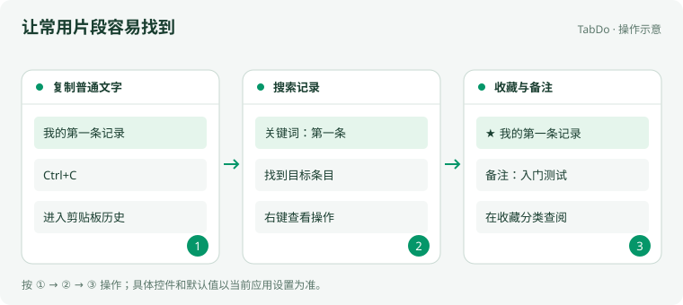

_从剪贴板选择内容，转入悬浮中转，再勾选、排序或拖出。插图为操作示意，具体控件以当前应用为准。_

### 开始前

在文本编辑器输入“我的第一条 TabDo 记录”，选中并 Ctrl+C。正式剪贴板采集与工具页面是否打开无关。

### 跟着做

1. 从超级面板固定项打开“剪贴板”，在历史列表找到刚复制的文字。

2. 在搜索框输入“第一条”，确认列表按关键词缩小；清空搜索恢复记录。

3. 点击条目左侧的勾选区域选择内容，再复制到编辑器核对。左侧整列都可勾选，不必精确点中小方框；它不会触发拖动粘贴。

4. 右键条目查看收藏、备注等操作；将这条文字加入收藏并填入便于识别的备注。

5. 切换到收藏分类，按正文或备注查找条目。需要取消时对同一条目执行取消收藏。

6. 在文本、图片或文件条目点击“悬浮中转”，或使用右侧“复制并粘贴”下方的中转按钮。多选时按钮显示数量，并逐条转入所选内容；空入口只打开中转，不加载全部历史。

7. 保持中转打开，再复制一段文字、一张图片或一些文件，观察新条目追加。选择“从新到旧”或“从旧到新”，新增内容会放到顶部或末尾；图片缩略图可点击放大。

8. 在中转左侧勾选同类型条目，也可用 Ctrl 切换、Shift 范围选择。点击“复制选中”，或拖动正文到接收内容的应用。中转内 Ctrl+A 可全选，再按一次取消全选。

9. 拖动删除按钮左侧的手柄调整顺序；也可用上移、下移按钮，或 Alt 拖动正文及 Alt+方向键。进入手动排序后，新复制追加到末尾。

10. 点击每条右侧的 × 删除条目，或用“清空”移除当前全部中转内容。结果提示约 3 秒后消失；混合文本、图片和文件复制或拖出时，会显示约 4 秒的禁止提示。

11. 关闭中转后再打开，应为空窗口；历史、收藏和原文件仍保留。图片的“悬浮固定”打开独立图片窗口，“标记图片”进入绘图，均不等同于中转。

### 应看到的结果

历史和收藏可以长期查阅，中转只保留本次窗口内容。多条文本按显示顺序复制或拖出；关闭剪贴板页面后，宿主仍会采集新的复制记录。

### 遇到问题

**列表为空？** 重新主动复制一段普通文字并稍等采集。确认搜索条件已清空；到通用设置检查保留天数。不要通过清理数据库排查。

**多选后为什么提示不能一起复制？** 文本、图片和文件需要分别操作，不能混合合并。单张图片可作为图片复制，多张图片一起复制时作为文件集合；拖放能否接收还取决于目标应用。

**复制内容不适合长期保存？** 可删除相应历史条目并调整保留天数。练习时使用普通示例文字，避免把密码等内容作为样例。

## 便签与悬浮图片

便签用于编辑临时文字，悬浮图片用于查看参考图。它们各自拥有独立窗口；收集剪贴板中的文本、图片和文件则使用悬浮中转。

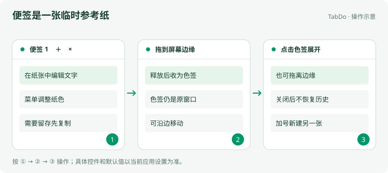

_编辑便签、拖到屏幕边缘收起、点击色签展开。插图为操作示意，具体控件以当前应用为准。_

### 开始前

准备一条普通文字或一张测试图片。先确认桌面有空间放置悬浮窗口。

### 跟着做

1. 从面板打开“便签”，在纸张内输入文字。文本、图片和文件的临时收集使用“悬浮中转”，不写入便签。

2. 拖动标题栏移动便签，在窗口菜单调整纸色、透明度和字号。需要另一张纸时点击加号；窗口内 Ctrl+N 可显式新建。

3. 便签默认字号为 14，可在选项中输入字号后按 Tab 确认。右上角的撤销、重做用于编辑回退；正文右键提供剪切、复制和粘贴。

4. 启用贴边后，将便签拖到屏幕边缘并释放，纸张收起为色签。点击色签，或把色签拖离边缘，即可展开。

5. 在剪贴板图片条目点击“悬浮固定”，按原图比例查看图片。需要画箭头或打码时使用“标记图片”；普通悬浮图片不进入绘图模式。

6. 用窗口关闭按钮结束便签或悬浮图片。需要留存的文字先复制到自己的文件；便签不保存或恢复历史。

### 应看到的结果

便签可编辑、移动和贴边，色签仍属于原窗口。关闭工具主页面后，可见的独立便签仍能继续使用。

### 遇到问题

**鼠标移上色签为什么不展开？** 色签使用点击展开，避免经过屏幕边缘时意外弹出；也可直接拖离边缘。

**悬浮的文本在哪里追加？** 从条目点击“悬浮中转”转入当前中转；窗口打开后新复制也会追加。关闭后内容销毁，再开是空窗口；便签和剪贴板历史不受影响。

## 截图、取色与标记

截图用于截取实际屏幕，取色返回选中位置的颜色，图片标记用于对已有图片添加说明。

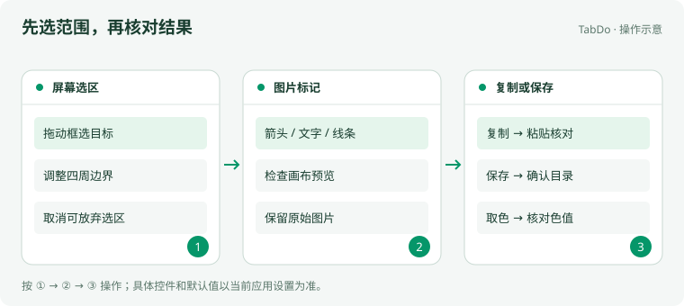

_框选屏幕区域，在标记画布调整，确认复制或保存。插图为操作示意，具体控件以当前应用为准。_

### 开始前

在屏幕上准备一块可公开的测试内容。截图取色会读取你实际看到的画面。

### 跟着做

1. 从面板点击“截图”，按住鼠标拖出需要的矩形，调整选区后使用界面上的确认或保存操作。

2. 将结果复制到剪贴板后，在目标文档粘贴，核对范围和清晰度；保存时确认文件名与目录。

3. 为已有图片加说明时，在资源管理器选中图片，呼出面板选择“图片标记”。

4. 在画布选择线条、箭头或文字等工具，完成后预览。保存到新文件名，保留原图用于比较。

5. 从面板选择“取色”，在屏幕上选取目标颜色，把结果粘贴到编辑器核对颜色值。

6. 不继续时使用当前界面的取消或关闭按钮；应用级 Esc 默认关闭，不要把它作为唯一退出方式。

### 应看到的结果

截图范围、标记内容和保存文件一致；取色得到可再次复制使用的颜色值。

### 遇到问题

**截到了不需要的窗口？** 先把目标内容摆好再启动截图。多显示器和不同缩放下，先用小选区核对位置。

**保存对话框取消后没有文件？** 取消不会写入文件。再次保存并在实际确认的目录检查，不要只根据预览判断已落盘。

## 文字、公式与翻译

文字识别和公式识别从图片提取内容，翻译使用已启用的提供商。先准备模型或服务，再检查结果是否准确。

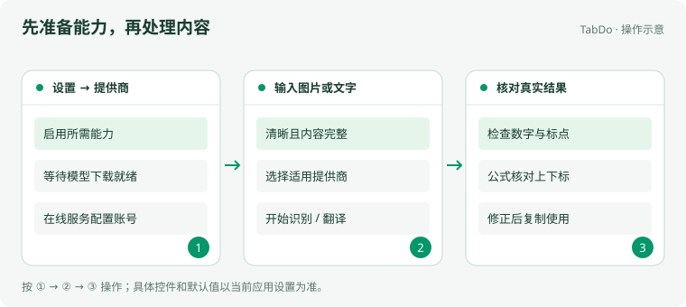

_在提供商准备能力，提交图片或文字，检查识别与翻译结果。插图为操作示意，具体控件以当前应用为准。_

### 开始前

打开“设置 → 提供商”，选择所需能力。离线模型首次使用需要下载；在线服务需要有效地址、密钥和支持相应输入的模型。

### 跟着做

1. 在“提供商”中启用所需识别或翻译能力，查看模型安装与就绪状态。下载完成后再处理图片。

2. 准备一张清晰的短文本图片，从文件匹配或工具入口打开文字识别，选择图片并开始处理。

3. 检查结果中的换行、标点和数字，必要时手动修正，再复制到编辑器核对。

4. 公式识别使用包含完整公式的清晰图片；同时检查 LaTeX 源码和渲染结果，尤其是上下标与分式。

5. 在文字识别结果中点击“翻译”，选择服务和语言。图上有选文时优先翻译选文，否则翻译完整识别文本；结果可单独复制。

6. 处理结束或取消后关闭工具。若服务需要联网，提交前确认本次输入适合交给所选服务。

### 应看到的结果

得到可复制的文字、公式源码或翻译结果。教程不会模拟服务成功，实际能力以模型和账号配置为准。

### 遇到问题

**提示没有可用提供商或模型未就绪？** 回到提供商检查开关、下载状态和默认项；AI 模型需支持图片输入才能进行图片识别。

**识别错误或请求失败？** 先裁掉无关区域并提高文字清晰度。在线失败时检查地址、模型、账号额度和代理；不要把失败提示当作识别结果。

## 文件搜索与整理

文件搜索通过 Everything 查询本地路径；重命名和解散文件夹用于实际整理。首次尝试先准备副本，再逐行检查预览。

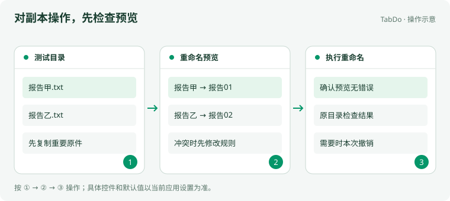

_选择测试副本，检查新文件名预览，再执行文件事务。插图为操作示意，具体控件以当前应用为准。_

### 开始前

Windows 上准备并运行 Everything，按文件搜索的安装指引确认连接。另建测试目录，放两份文件副本及一个带文件的子文件夹。

### 跟着做

1. 打开“文件搜索”，输入文件名。左侧选择图片、PDF、视频等类别；清空关键词也能按类别列举文件。

2. 使用排序和分栏查看结果，确认文件路径后再打开。搜索方式和安装指引可在工具设置中调整。

3. 在资源管理器选中测试文件，呼出面板打开重命名工具，设置规则或逐个输入新名称。

4. 逐行检查预览中的原名、新名和错误；冲突、仍在校验或无效名称需先处理，再点击“执行重命名”。

5. 成功后在原目录检查文件。需要撤回时使用本次撤销功能；外部程序再次修改文件可能影响撤销。

6. 解散文件夹时选中测试子文件夹，确认冲突策略。工具会移动其内容并删除空目录，完成后检查父目录。

### 应看到的结果

搜索显示真实路径，重命名结果与预览一致，文件整理后的内容和数量正确。

### 遇到问题

**搜索显示未连接？** 按工具内安装指引安装并运行 Everything，等待索引完成。教程不提供搜索模拟结果。

**重命名按钮不可用？** 查看校验提示，处理重名、无效字符、父子混合或文件被占用等问题；外部改动后先刷新预览。

## 图片处理与拼接

在图片处理界面导入队列、设置参数并预览，再输出新文件。合并图片可按指定顺序和布局组合多张图片。

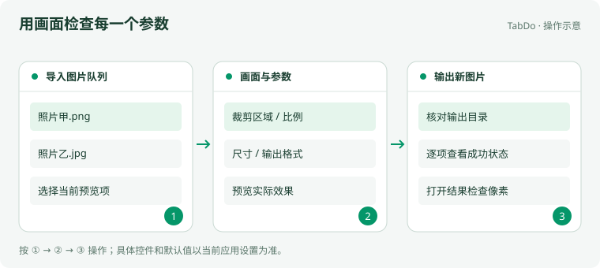

_导入图片队列，查看画面与尺寸，确认后输出新文件。插图为操作示意，具体控件以当前应用为准。_

### 开始前

准备两张普通 PNG 或 JPEG 图片副本，确认输出磁盘有空间。初次只处理小批量文件。

### 跟着做

1. 选中图片后从面板打开图片处理；也可进入工具后添加文件。文件夹入口用于批量读取目录。

2. 在队列中选中图片，查看原始尺寸及画面。切换处理方式，使用尺寸或比例预选，再按需要微调数值。

3. 裁剪时在画面中框选区域，检查边缘。改变尺寸、比例或格式后重新查看实际效果预览。

4. 选定输出格式和目录。默认输出到各源文件同级目录；没有来源路径的剪贴板图片回退到下载目录，自定义目录按已保存设置处理。

5. 确认队列与参数后开始处理，查看每项成功或失败状态。打开输出目录核对文件、像素尺寸和透明背景。

6. 拼接时调整图片顺序和布局，检查拼接画面再输出。保留源图，确认结果后再决定是否删除副本。

### 应看到的结果

新图片的尺寸、裁剪范围、顺序和格式符合预览。损坏文件应单独报错，不代表其他文件也失败。

### 遇到问题

**有一张图片打不开？** 查看该文件的错误，尝试用系统图片应用打开。可以移除损坏文件继续检查其他项。

**输出位置和预想不同？** 核对是否保存过自定义目录；多来源文件默认各回各的源目录。以实际成功结果和文件位置为准。

## 视频处理与录屏

视频处理用于已有文件，录屏用于捕获屏幕。两种流程都先用几秒钟样片检查画面、声音和输出位置，再处理长视频。

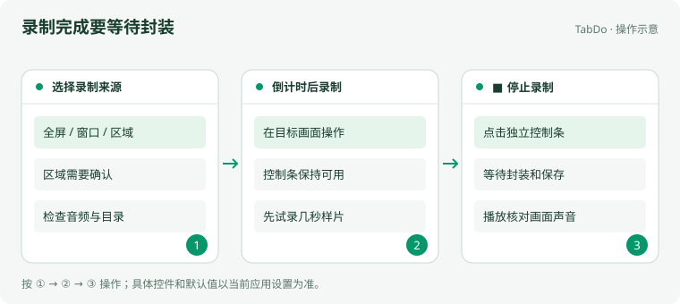

_选择录制目标与声音，开始录制，用独立控制条停止并检查文件。插图为操作示意，具体控件以当前应用为准。_

### 开始前

录屏需 Windows 10 1903 或更高版本。准备好录制画面和输出目录；需要声音时确认麦克风与系统音频设备。

### 跟着做

1. 处理已有视频：导入副本，在时间轴移动播放位置，设置片段起点和终点，核对画面裁剪及输出参数。

2. 开始处理后查看队列状态；完成后实际播放输出视频，检查长度、画面与声音。

3. 录屏：从面板打开“录屏”，选择全屏、窗口或区域。区域模式需框选并明确确认，窗口模式需选择正确窗口。

4. 按需设置系统声音、麦克风、倒计时和输出目录。正式录制前用短样片检查设备，倒计时后再进行操作。

5. 用独立控制条的停止按钮结束，等待封装和保存完成。F10 只有在快捷键设置中明确启用时才可用。

6. 实际播放保存文件，核对声音和片长，再开始长时间录制。取消启动时使用当前选择窗口的取消按钮。

### 应看到的结果

文件能正常播放，片段、画面和声音符合选择。控制条停止后需要等文件封装完成。

### 遇到问题

**没有声音或录错窗口？** 检查所选来源与音频开关，先录几秒核对。不同音频设备、系统版本和全屏应用需要实际验证。

**停止后文件还没出现？** 等待封装并检查输出目录与错误提示。不要在保存期间直接结束进程；异常时保留提示中的可恢复文件。

## 扫码与网页快开

扫码用于读取图片中的二维码；网页快开用于管理搜索网站，再将本次选中的文字或图片交给所选网站。

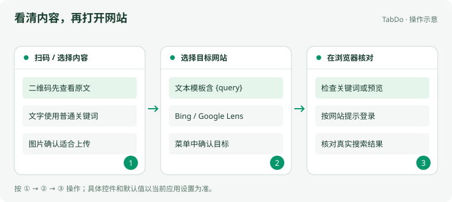

_扫描图片查看原文，或选择搜索网站后在浏览器查看结果。插图为操作示意，具体控件以当前应用为准。_

### 开始前

准备一张普通二维码图片和测试关键词。网页搜索需要网络；以图搜图会上传本次选中的图片。

### 跟着做

1. 打开二维码扫描，选择或粘贴图片，检查结果；复制原文后先核对，再决定是否打开其中的链接。

2. 二维码较小时先裁掉无关部分，保持四周留白且不要切掉边角。

3. 在网页快开配置文本搜索网站，搜索模板使用包含 {query} 的 HTTP 或 HTTPS 地址。

4. 选中或复制文字后呼出面板，选择“网页搜索”；若有多个启用网站，在选择菜单中点击目标。

5. 以图搜图时确认图片适合上传，再选择 Bing 或 Google Lens。浏览器打开后检查预览与结果，可能遇到登录或访问限制。

### 应看到的结果

二维码结果与图片内容相符，网页搜索在默认浏览器打开目标网站并带上本次输入。

### 遇到问题

**扫码没有结果？** 确认图片清晰、编码完整且未过度倾斜。重拍或换原图，不要仅放大低清图片。

**网页打不开或要求登录？** 在浏览器中按提示处理网络、登录或验证。取消菜单后可重新选择；不要把打开浏览器当作搜索已经成功。

## 快捷键与插件

把常用操作固定在面板，按需要启用快捷键，再通过插件扩展功能。支持临时常驻的页面可由用户保留为独立会话。

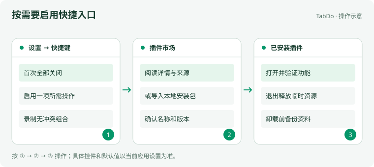

_在快捷键集中设置操作，从市场安装后在已安装插件中管理。插图为操作示意，具体控件以当前应用为准。_

### 开始前

确定希望用快捷键打开的一个功能。安装第三方插件前阅读其功能、来源和权限说明。

### 跟着做

1. 到“快捷键 → 内置快捷键”启用需要的操作，例如关闭、Esc 或停止录屏；首次状态全部关闭。

2. 设置从其他应用打开 TabDo 设置页的呼出快捷键。若冲突，换一个组合后保存并在其他应用中测试。

3. 直接启动工具时添加应用或全局指令快捷键，选择准确的目标功能。固定项、别名与快捷键可分别管理。

4. 打开“插件市场”，查看详情后安装；也可使用本地插件安装包，在安装预览中核对名称与版本。

5. 在“已安装插件”打开或管理插件。退出后释放临时运行资源，安装文件和持久资料仍保留。

6. 若页面支持临时常驻，点击宿主标题栏右上角的“临时常驻”开关。嵌入页面会先分离，之后隐藏或最小化可保留；再次点击取消会立即关闭这次独立会话。

7. 区分临时常驻和图钉置顶：前者保留会话，后者调整窗口层级。临时常驻默认关闭，不跨重启保存；并非所有页面都提供此开关。

8. 卸载前确认是否选择删除插件资料，需要留存时先备份。更新 TabDo 程序本身不要求清空已有插件。

### 应看到的结果

启用的快捷键立即生效，关闭的快捷键不再拦截；插件能通过正常入口打开和关闭。

### 遇到问题

**快捷键突然不工作？** 检查是否启用、是否冲突，以及游戏模式或全屏暂停是否生效。全局指令和应用内快捷键的作用范围不同。

**找不到旧版退出保活设置？** 旧的退出保活和随宿主启动设置已移除。需要保留当前页面时，使用支持页面右上角的“临时常驻”；开发者不能自动替你开启。

## 备份、迁移与排查

更新程序、更换电脑或调整资料目录前，先导出完整备份。程序文件与用户资料分开管理，迁移和恢复由退出后的工作进程执行。

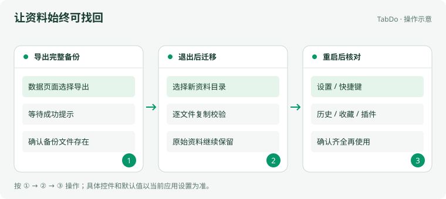

_导出备份并核对，退出后迁移，重启检查配置与插件。插图为操作示意，具体控件以当前应用为准。_

### 开始前

准备有足够空间的备份位置。免安装预览与正常安装可使用不同资料，不要通过直接启动预览 exe 混用数据。

### 跟着做

1. 打开“数据”页面，导出完整备份并选定位置。应用退出后完成备份并重启；重开页面确认成功结果和备份文件。备份包含密钥和插件私有资料，当前不加密。

2. 迁移前记下当前数据目录。在“通用设置 → 数据与缓存目录”选择新位置，按原生确认提示操作。

3. 程序会在退出后复制并逐文件校验，保留原件，再记录新位置并重启。不要在运行时手工复制数据库。

4. 重启后检查设置、固定项、快捷键、剪贴板历史、收藏和已安装插件，确认齐全后继续使用。

5. 恢复前先导出现阶段的新资料，再从“数据”页面选择恢复并核对结果。不要手工合并不同阶段的数据库目录。

6. 更新时退出 TabDo 后再替换程序资源。仓库预览始终用 PreviewPortable.cmd 启动，保留其 data 与 legacy 目录。

7. 记录问题的版本、步骤和错误原文。先检查对应设置与文件位置，反馈时不要附带密钥、私人历史或完整个人数据库。

### 应看到的结果

备份可定位，迁移后资料完整，原目录仍保留。阅读本教程本身不复制、不删除、不重置任何用户资料。

### 遇到问题

**启动后像全新安装一样？** 先退出，确认启动器与原数据目录是否正确；不要立即导入或覆盖空目录。检查原件与备份后按恢复流程处理。

**目标路径失效或迁移报错？** 保留原件，恢复磁盘或目录的可访问性，再按提示重试。不要删除原数据库或回退到空白资料来绕过错误。

## 维护与验证

应用内正文维护在 `internal-plugins/setting/src/views/UsageGuide/tutorialChapters.ts`，页面为同目录的 `UsageGuide.vue`，插图位于设置插件的 `public/tutorial/`。更新时同步本页，保持章标识、步骤和问题解答一致；维护索引不会自动改写教程正文。

插图为项目原创，按 MIT 许可分发，不依赖网络字体或外部脚本。通过 `pnpm test:e2e tests/e2e/local-tutorial.spec.ts` 从真实关于入口验证章节、图片、搜索、离线阅读及重启资料保留。源码流程和设备功能验收分别记录，录屏声音、多屏、DPI 和特殊格式仍按各工具能力核验。
